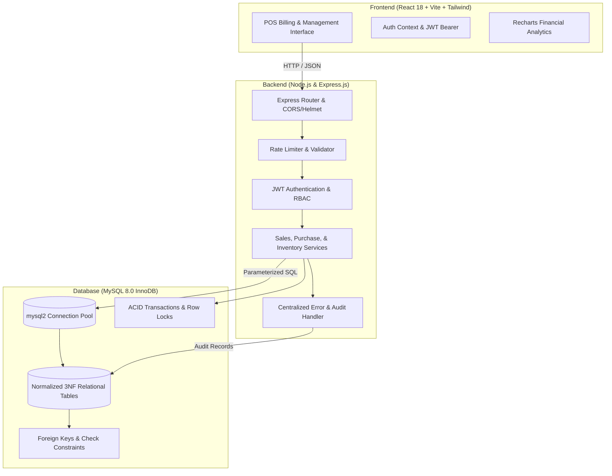
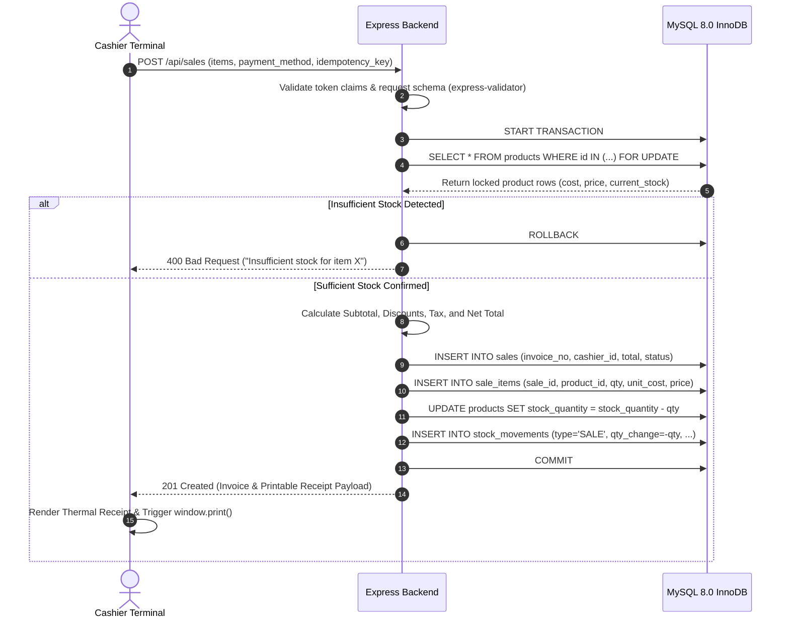
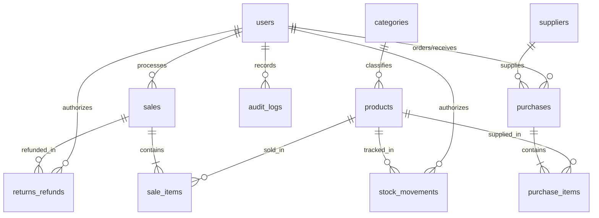

# Retail Inventory and Sales Management System

A full-stack, database-driven web application designed for academic BTech capstone assessment and real-world commercial retail environments. The system digitizes product inventory, point-of-sale (POS) billing, supplier restocking, transaction-safe stock decrements, and financial profit reporting using MySQL 8.0, Node.js/Express, and React 18 with Vite and Tailwind CSS.

---

## 1. System Architecture Diagram



---

## 2. Point-of-Sale Data Flow Diagram



---

## 3. Entity-Relationship (ER) Diagram



---

## 4. Key Features & Operational Modules

### 4.1 Point of Sale (POS) Billing Station
- Real-time instant search by product name, SKU code, or barcode scan.
- Interactive cart with quantity steppers respect available inventory stock limits.
- Configurable tax percentage, manual discounts, and multiple payment modes: **Cash**, **Card**, and **UPI QR**.
- Automated generation of unique invoice numbers (`INV-YYYYMMDD-XXXX`).
- Client-side idempotency protection against duplicate network submissions.
- Formatted modal receipt supporting instant browser thermal printing (`window.print()`).

### 4.2 Transaction-Safe Inventory & Restocking
- Row-level locking (`SELECT ... FOR UPDATE`) prevents overselling under high concurrency.
- Purchase order lifecycle: Draft -> Ordered -> Received. Stock is atomically increased only when goods are formally acknowledged at the dock.
- Mandatory reason tracking for all manual stock adjustments (Damage, Expiry, Return, Audit Correction).
- Automatic audit logging for every single stock addition or deduction in `stock_movements`.

### 4.3 Financial Reporting & True Profit Separation
- **Gross Revenue**: Sum of customer invoiced receipts.
- **Cost of Goods Sold (COGS)**: Sum of historical acquisition costs (`quantity * unit_cost`) captured at the exact moment of sale.
- **Gross Profit**: `Gross Revenue - COGS`.
- **Profit Margin %**: `(Gross Profit / Gross Revenue) * 100`.
- Best-selling products report, sales by category chart, and inventory valuation based on wholesale cost basis.
- One-click CSV export for all reporting tables.

### 4.4 User Governance & Last Admin Safeguard
- Role-Based Access Control (RBAC) enforced in server middleware across three roles:
  1. **Admin / Store Owner**: Full access to store telemetry, financial reports, user management, and audit logs.
  2. **Cashier / Sales Staff**: Dedicated to the POS register, sales records, and receipt printing.
  3. **Inventory Manager / Stock Lead**: Manages products, categories, suppliers, purchase orders, and stock movements.
- Security constraint: System refuses to deactivate or demote the last remaining active Administrator.

---

## 5. Technology Stack

- **Frontend**: React 18, Vite, Tailwind CSS, Lucide React, Recharts, Axios
- **Backend**: Node.js, Express.js, `mysql2/promise`, `bcryptjs`, `jsonwebtoken`, `helmet`, `morgan`, `express-rate-limit`
- **Database**: MySQL 8.0 (InnoDB engine, 3NF normalization, foreign key constraints)
- **Testing**: Jest, Supertest

---

## 6. Software Prerequisites

- **Node.js**: v18.0.0 or higher (v20+ LTS recommended)
- **MySQL Server**: v8.0 or compatible
- **Operating System**: Windows, macOS, or Linux

---

## 7. Installation & Quickstart Guide

### Step 1: Open the Project Directory
```powershell
cd C:\Users\dipte\.gemini\antigravity-ide\scratch\retail-inventory-system
```

### Step 2: Configure Environment Variables
Copy `.env.example` to `server/.env` and configure your MySQL credentials:
```ini
PORT=5000
NODE_ENV=development

# MySQL Database Configuration
DB_HOST=localhost
DB_PORT=3306
DB_USER=root
DB_PASSWORD=your_mysql_password_here
DB_NAME=retail_management

# Security & Authentication
JWT_SECRET=super_secure_retail_jwt_secret_key_2026_xyz!
JWT_EXPIRES_IN=8h

# CORS
CLIENT_URL=http://localhost:5173
```

### Step 3: Initialize Database Schema & Seed Realistic Data
Run the automated migration runner:
```powershell
cd server
npm run db:init
```
*This executes `database/schema.sql` and `database/seed.sql`, creating the database, 12 relational tables, constraints, indexes, and pre-loading 20 products, categories, suppliers, and sample transactions.*

### Step 4: Run Automated Verification Tests
```powershell
cd server
npm test
```
*Executes all 18 automated integration tests covering RBAC, input validation, and business calculations.*

### Step 5: Start the Backend API Server
```powershell
cd server
npm run dev
```
*The API server will listen on `http://localhost:5000`.*

### Step 6: Start the Frontend Application
In a separate terminal:
```powershell
cd client
npm run dev
```
*The React application will be available at `http://localhost:5173`.*

---

## 8. Demonstration Accounts

The database seed provides three pre-configured accounts:

| Role | Email | Password | Allowed Permissions |
| :--- | :--- | :--- | :--- |
| **Administrator** | `admin@retail.com` | `Admin@123` | Full system access, users, settings, financial reports |
| **Cashier** | `cashier@retail.com` | `Cashier@123` | POS billing, personal sales history, receipt printing |
| **Inventory Manager** | `manager@retail.com` | `Manager@123` | Catalog, purchase orders, restock receiving, valuation |

*The login page also provides one-click demo credential buttons for instant testing.*

---

## 9. Academic SQL Concepts Demonstrated

1. **Primary Keys**: Surrogate auto-increment keys (`INT AUTO_INCREMENT PRIMARY KEY`) across every entity guarantee entity integrity.
2. **Foreign Keys & Referential Integrity**: Relationships between `products.category_id` -> `categories.category_id` and `sale_items.sale_id` -> `sales.sale_id` are enforced with `ON DELETE RESTRICT` to guarantee historical billing permanence.
3. **Check Constraints**: `CHECK (stock_quantity >= 0)` and `CHECK (cost_price >= 0)` prevent corrupt or negative inventory balances at the storage engine level.
4. **Relational Joins**: Multi-table `INNER JOIN` and `LEFT JOIN` queries combine sales with cashier details, products with departments, and purchases with receiving staff.
5. **SQL Aggregations**: `SUM()`, `COUNT()`, `AVG()`, and `GROUP BY` power the real-time financial dashboards without in-memory calculations.
6. **ACID Transactions**: POS sales and purchase dock receipts use explicit `START TRANSACTION`, `COMMIT`, and `ROLLBACK` blocks with row locks (`FOR UPDATE`) for concurrency safety.
7. **Indexes**: Composite indexes on `(role, is_active)` and single-column indexes on unique codes (`sku`, `barcode`, `invoice_number`) guarantee sub-millisecond query performance.
8. **Normalization (3NF)**: Redundant data is eliminated; categories and suppliers reside in dedicated tables, while point-of-sale costs are snapshot-preserved in line items.

---

## 10. Troubleshooting

- **MySQL Access Denied (Error 1045)**: Ensure the `DB_PASSWORD` in `server/.env` matches your local MySQL `root` password.
- **Port 5000 already in use**: Change `PORT=5001` in `server/.env` and update the proxy target in `client/vite.config.js`.
- **CORS Errors**: Verify that `CLIENT_URL` in `server/.env` matches your browser address (default `http://localhost:5173`).
