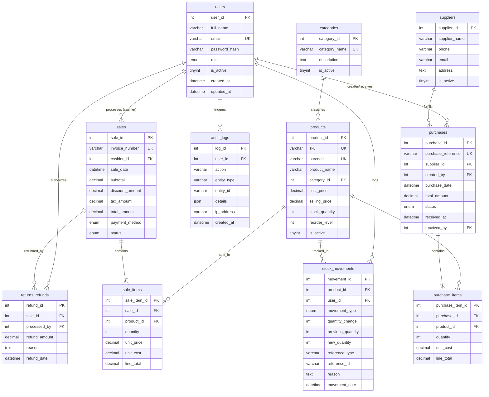

# Retail Inventory and Sales Management System - Database Design Specification

## 1. Relational Architecture & Normalization

The database for the system is designed under Third Normal Form (3NF) principles:
- **First Normal Form (1NF)**: Every column contains atomic values, records have unique primary keys (`user_id`, `product_id`, `sale_id`, etc.), and there are no repeating groups.
- **Second Normal Form (2NF)**: All non-key attributes are fully functionally dependent on the entire primary key, eliminating partial dependencies.
- **Third Normal Form (3NF)**: Transitive functional dependencies are eliminated. For instance, `category_name` is stored exclusively in `categories` and referenced via foreign key `category_id` in `products`. Product cost at the moment of sale is recorded in `sale_items.unit_cost` to maintain historical financial truth regardless of subsequent price alterations.

---

## 2. Entity-Relationship (ER) Diagram



---

## 3. Data Dictionary & Table Definitions

### 3.1 `users` Table
Stores authentication credentials, security status, and system authorization roles.
- `user_id`: `INT AUTO_INCREMENT PRIMARY KEY`
- `full_name`: `VARCHAR(100) NOT NULL`
- `email`: `VARCHAR(150) NOT NULL UNIQUE` (Indexed for O(1) authentication lookups)
- `password_hash`: `VARCHAR(255) NOT NULL` (Standard bcrypt hashed format)
- `role`: `ENUM('ADMIN', 'CASHIER', 'INVENTORY_MANAGER') NOT NULL`
- `is_active`: `TINYINT(1) NOT NULL DEFAULT 1`

### 3.2 `categories` Table
Organizes merchandise into operational store departments.
- `category_id`: `INT AUTO_INCREMENT PRIMARY KEY`
- `category_name`: `VARCHAR(100) NOT NULL UNIQUE`
- `description`: `TEXT NULL`
- `is_active`: `TINYINT(1) NOT NULL DEFAULT 1`

### 3.3 `suppliers` Table
Tracks external wholesale distributors providing replenishment goods.
- `supplier_id`: `INT AUTO_INCREMENT PRIMARY KEY`
- `supplier_name`: `VARCHAR(150) NOT NULL`
- `phone`: `VARCHAR(30) NULL`
- `email`: `VARCHAR(150) NULL`
- `address`: `TEXT NULL`
- `is_active`: `TINYINT(1) NOT NULL DEFAULT 1`

### 3.4 `products` Table
Master inventory catalog containing SKU codes, barcode scans, pricing, and stock balances.
- `product_id`: `INT AUTO_INCREMENT PRIMARY KEY`
- `sku`: `VARCHAR(50) NOT NULL UNIQUE`
- `barcode`: `VARCHAR(100) UNIQUE NULL`
- `product_name`: `VARCHAR(200) NOT NULL`
- `category_id`: `INT NOT NULL` (Foreign Key referencing `categories.category_id`)
- `cost_price`: `DECIMAL(10,2) NOT NULL CHECK (cost_price >= 0)`
- `selling_price`: `DECIMAL(10,2) NOT NULL CHECK (selling_price >= 0)`
- `stock_quantity`: `INT NOT NULL DEFAULT 0 CHECK (stock_quantity >= 0)` (Enforces invariant: stock cannot drop below zero)
- `reorder_level`: `INT NOT NULL DEFAULT 10 CHECK (reorder_level >= 0)`
- `is_active`: `TINYINT(1) NOT NULL DEFAULT 1`

### 3.5 `sales` Table
Header ledger for point-of-sale customer transactions.
- `sale_id`: `INT AUTO_INCREMENT PRIMARY KEY`
- `invoice_number`: `VARCHAR(50) NOT NULL UNIQUE`
- `cashier_id`: `INT NOT NULL` (Foreign Key referencing `users.user_id`)
- `sale_date`: `DATETIME NOT NULL DEFAULT CURRENT_TIMESTAMP`
- `subtotal`: `DECIMAL(10,2) NOT NULL CHECK (subtotal >= 0)`
- `discount_amount`: `DECIMAL(10,2) NOT NULL DEFAULT 0.00`
- `tax_amount`: `DECIMAL(10,2) NOT NULL DEFAULT 0.00`
- `total_amount`: `DECIMAL(10,2) NOT NULL CHECK (total_amount >= 0)`
- `payment_method`: `ENUM('CASH', 'CARD', 'UPI') NOT NULL`
- `payment_status`: `ENUM('PAID', 'PENDING', 'FAILED', 'REFUNDED') NOT NULL DEFAULT 'PAID'`
- `status`: `ENUM('COMPLETED', 'CANCELLED', 'REFUNDED') NOT NULL DEFAULT 'COMPLETED'`

### 3.6 `sale_items` Table
Itemized line entries for each product sold in a transaction.
- `sale_item_id`: `INT AUTO_INCREMENT PRIMARY KEY`
- `sale_id`: `INT NOT NULL` (Foreign Key referencing `sales.sale_id`)
- `product_id`: `INT NOT NULL` (Foreign Key referencing `products.product_id`)
- `quantity`: `INT NOT NULL CHECK (quantity > 0)`
- `unit_price`: `DECIMAL(10,2) NOT NULL CHECK (unit_price >= 0)`
- `unit_cost`: `DECIMAL(10,2) NOT NULL CHECK (unit_cost >= 0)` (Crucial snapshot of cost at sale time)
- `discount_amount`: `DECIMAL(10,2) NOT NULL DEFAULT 0.00`
- `line_total`: `DECIMAL(10,2) NOT NULL CHECK (line_total >= 0)`

### 3.7 `stock_movements` Table
Immutable audit trail recording every addition, deduction, or adjustment to inventory.
- `movement_id`: `INT AUTO_INCREMENT PRIMARY KEY`
- `product_id`: `INT NOT NULL` (Foreign Key referencing `products.product_id`)
- `user_id`: `INT NOT NULL` (Foreign Key referencing `users.user_id`)
- `movement_type`: `ENUM('PURCHASE', 'SALE', 'RETURN', 'DAMAGE', 'EXPIRED', 'ADJUSTMENT') NOT NULL`
- `quantity_change`: `INT NOT NULL` (Signed integer: positive for stock in, negative for stock out)
- `previous_quantity`: `INT NOT NULL CHECK (previous_quantity >= 0)`
- `new_quantity`: `INT NOT NULL CHECK (new_quantity >= 0)`
- `reference_type`: `VARCHAR(50) NOT NULL` (e.g. `SALE`, `PURCHASE`, `MANUAL_ADJUSTMENT`)
- `reference_id`: `VARCHAR(50) NOT NULL` (e.g. Invoice Number or PO Reference)
- `reason`: `TEXT NULL`
- `movement_date`: `DATETIME NOT NULL DEFAULT CURRENT_TIMESTAMP`

---

## 4. Concurrency Control and Transaction Safety

To avoid **race conditions** and **overselling** when concurrent cashiers ring up the same product:

```sql
-- 1. Begin ACID Database Transaction
START TRANSACTION;

-- 2. Sort Product IDs numerically and acquire exclusive row locks
SELECT product_id, product_name, cost_price, selling_price, stock_quantity 
FROM products 
WHERE product_id IN (1, 6) 
FOR UPDATE;

-- 3. In application layer: Verify stock_quantity >= requested_quantity
-- If insufficient, ROLLBACK immediately with user-friendly error.

-- 4. Insert sales header & line items
INSERT INTO sales (invoice_number, cashier_id, total_amount, payment_method, status) VALUES (...);
INSERT INTO sale_items (sale_id, product_id, quantity, unit_price, unit_cost, line_total) VALUES (...);

-- 5. Atomically deduct stock
UPDATE products SET stock_quantity = stock_quantity - ? WHERE product_id = ?;

-- 6. Insert audit stock movement
INSERT INTO stock_movements (product_id, user_id, movement_type, quantity_change, ...) VALUES (...);

-- 7. Finalize and release locks
COMMIT;
```

---

## 5. Key SQL Queries & Analytics

### 5.1 Calculating Gross Profit Distinct from Revenue
```sql
SELECT 
  s.invoice_number,
  s.total_amount AS gross_revenue,
  COALESCE(SUM(si.quantity * si.unit_cost), 0) AS cost_of_goods_sold,
  (s.total_amount - COALESCE(SUM(si.quantity * si.unit_cost), 0)) AS gross_profit,
  ROUND(((s.total_amount - COALESCE(SUM(si.quantity * si.unit_cost), 0)) / s.total_amount) * 100, 2) AS profit_margin_pct
FROM sales s
JOIN sale_items si ON s.sale_id = si.sale_id
WHERE s.status = 'COMPLETED'
GROUP BY s.sale_id
ORDER BY s.sale_date DESC;
```

### 5.2 Low Stock Alert Query
```sql
SELECT 
  p.sku,
  p.product_name,
  c.category_name,
  p.stock_quantity,
  p.reorder_level
FROM products p
JOIN categories c ON p.category_id = c.category_id
WHERE p.is_active = 1 AND p.stock_quantity <= p.reorder_level
ORDER BY p.stock_quantity ASC;
```

### 5.3 Inventory Valuation
```sql
SELECT 
  COUNT(*) AS total_skus,
  SUM(stock_quantity) AS total_inventory_units,
  SUM(stock_quantity * cost_price) AS total_wholesale_cost_valuation,
  SUM(stock_quantity * selling_price) AS total_retail_value,
  SUM((stock_quantity * selling_price) - (stock_quantity * cost_price)) AS potential_gross_profit
FROM products
WHERE is_active = 1;
```
